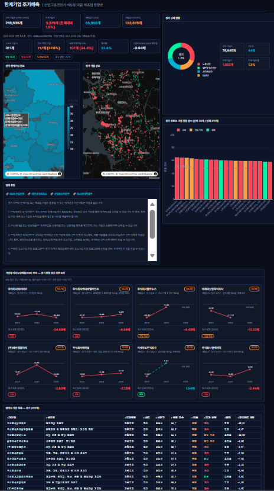
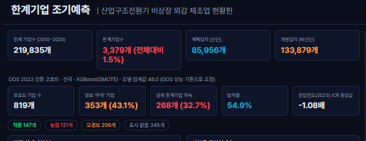
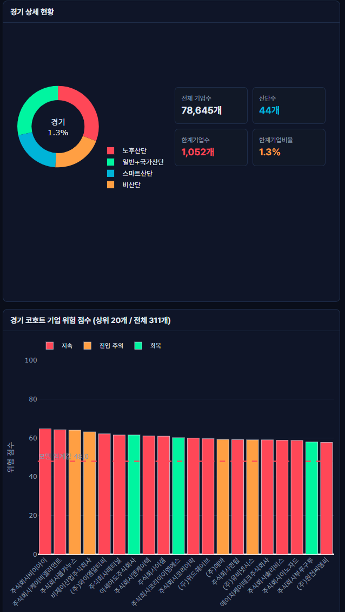
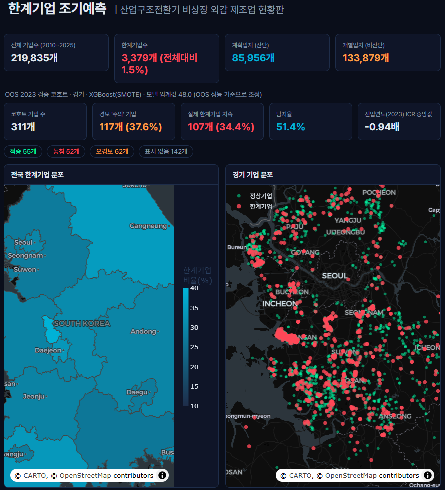
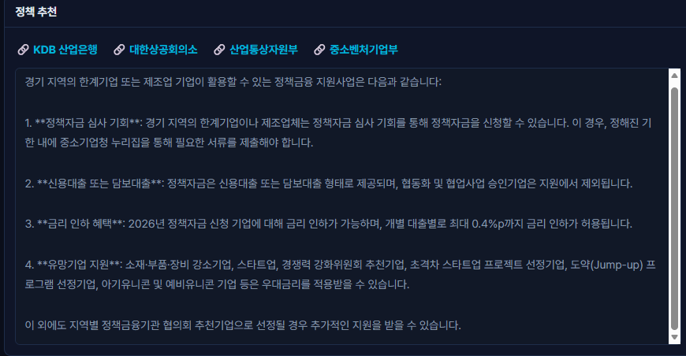
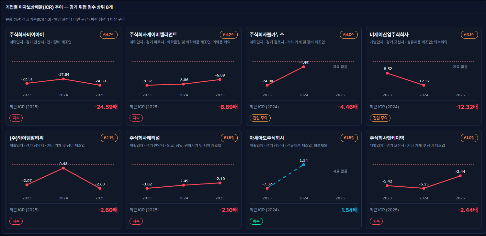
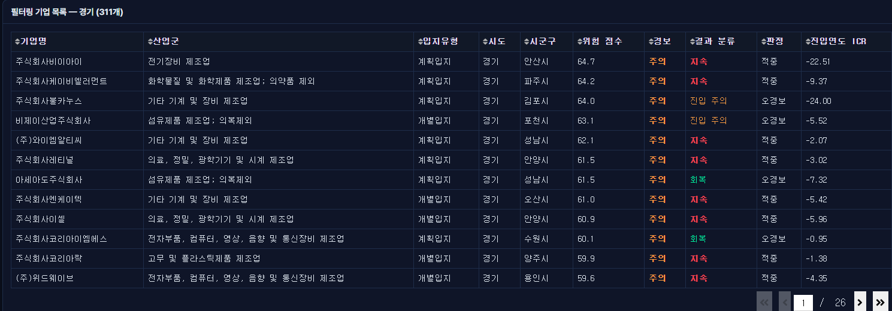

# 📊 산업구조 전환기 비상장 외감 제조업 한계기업 조기예측 - 대시보드 상세 소개

본 프로젝트의 인터랙티브 웹 대시보드 상세 구성 및 주요 기능 설명입니다.

---

## 1. 메인 전체 화면
- 대시보드의 전체 레이아웃을 한눈에 확인할 수 있는 개요 화면입니다.

---

## 2. KPI 영역 및 검증 지표
- 상단 핵심 지표 카드와 OOS 검증 코호트 지표를 통해 모델의 조기예측 성능을 수치로 전달합니다.

---

## 3. 지역 상세 현황 (파이차트 & 막대그래프)
- 선택한 지역의 산단 구성비와 위험 점수 상위 기업의 순위 시각화 패널입니다.

---

## 4. 전국 및 지역 한계기업 분포 지도
- 공간 분석을 바탕으로 전국 및 시도별 한계기업 밀집도를 보여주는 지도 패널입니다.

---

## 5. RAG & LLM 기반 맞춤형 정책 추천
- 지역 및 기업 위험도 진단 결과와 정책 문서를 연동(RAG)하여 맞춤형 지원 사업을 요약·추천합니다.

---

## 6. 기업별 이자보상배율(ICR) 추이
- 개별 기업의 ICR 과거 추이와 모델 예측 결과(적중/놓침/오경보)를 카드 형태로 제공합니다.

---

## 7. 필터링된 기업 목록 테이블
- 분석 대상 기업 전체의 상세 재무 및 위험도 데이터 목록을 조회할 수 있는 표입니다.

